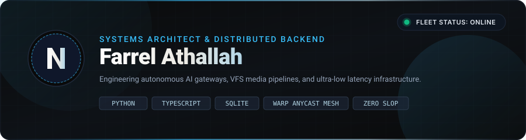
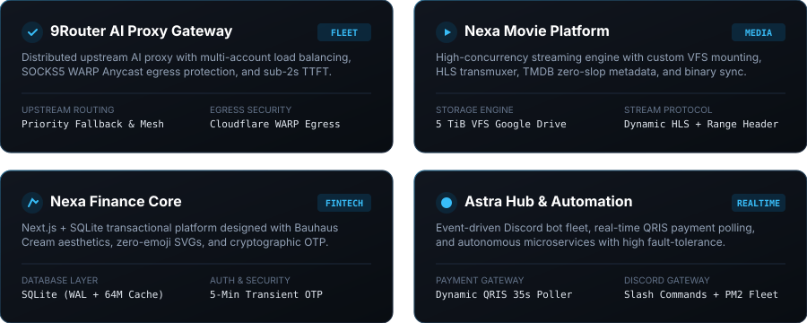
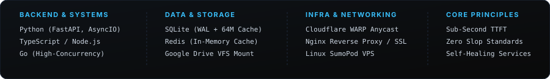

  

  
  &nbsp;
  
  &nbsp;
  

 

### 🛰️ The Engineering Fleet

  

### ⚡ Core Technologies & Principles

  

  Built with relentless precision &bull; Minimalist Luxury Architecture &bull; Farrel Athallah

