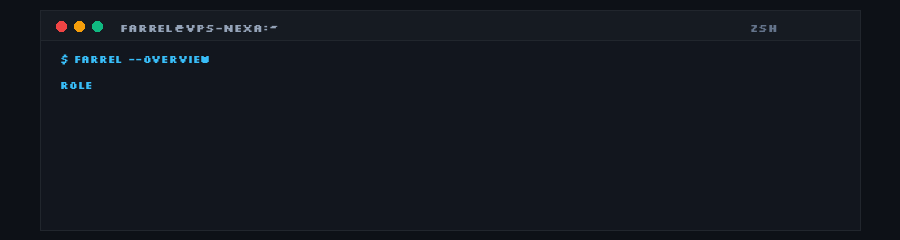

  

  
  
  

 

  

 

### 🛠️ Featured Systems &amp; Projects

- **[Nexa Movie](https://nexamovie.web.id)**  
  High-concurrency streaming backend mounted to a 5 TiB Google Drive VFS. Features custom HLS transmuxing, sub-second audio/subtitle sync, and automated TMDB metadata ingestion.
  `Python` • `FastAPI` • `Rclone VFS` • `HLS`

- **9Router Gateway**  
  High-throughput AI routing proxy orchestrating multi-account upstream APIs. Integrated with Cloudflare WARP SOCKS5 mesh, dynamic priority fallback, and sub-2s TTFT.
  `Node.js` • `WARP Anycast` • `SOCKS5` • `Next.js`

- **[Nexa Finance](https://nexafinance.web.id)**  
  Personal finance &amp; ledger web application built with a high-performance SQLite WAL storage engine (64 MB cache, 256 MB mmap) and transient OTP authentication.
  `Next.js` • `SQLite WAL` • `TailwindCSS` • `Resend`

- **Astra Hub &amp; Automation Fleet**  
  Event-driven backend coordinating dynamic QRIS payment polling (35s interval), Discord slash command microservices, and autonomous server health checks on PM2.
  `Node.js` • `PM2` • `Discord.js` • `REST API`

 

---

  Building systems, solving problems, and keeping it clean.

